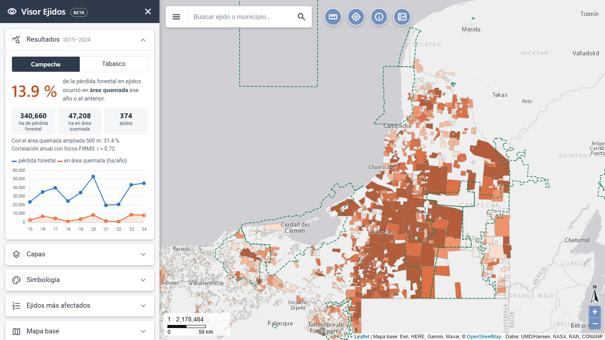
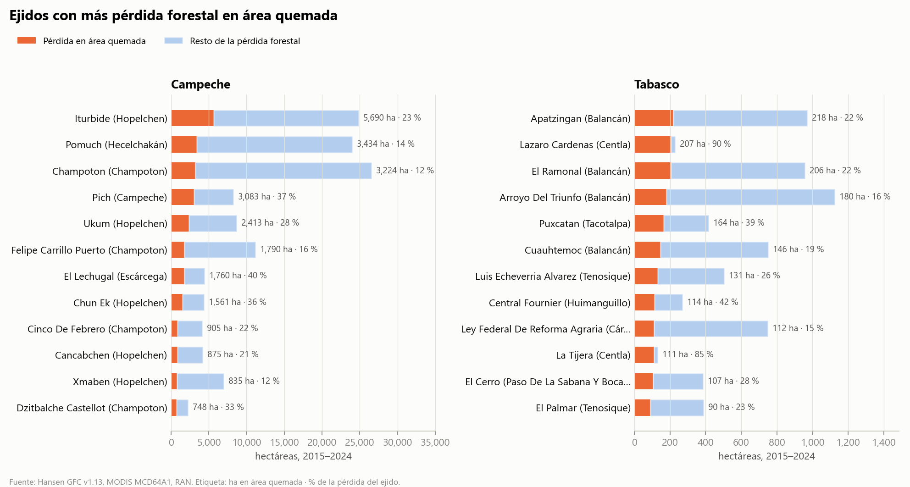
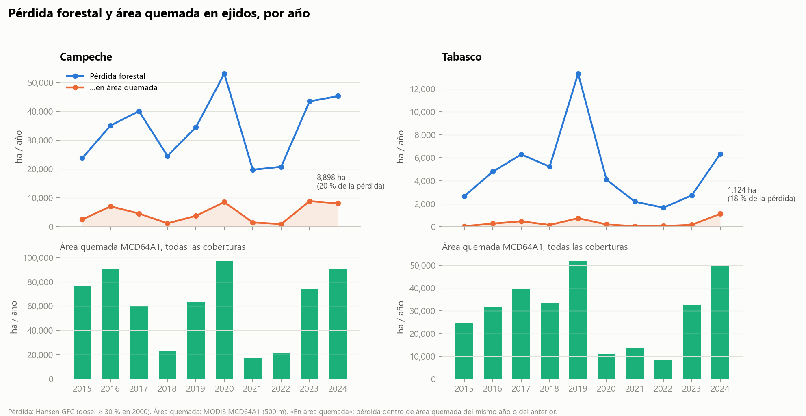
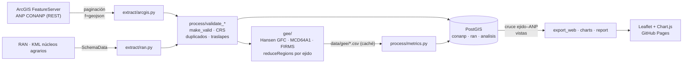

# Fuego y pérdida forestal en ejidos del sureste de México

[](https://github.com/jdanifalcon/ejidos-fuego-peninsula/actions/workflows/ci.yml)


**Pregunta:** ¿qué proporción de la pérdida de cobertura forestal en los ejidos coincide con áreas quemadas,
y qué ejidos son los más afectados?

**Fase 1:** Campeche y Tabasco, 2015–2024 · **Fase 2:** Quintana Roo y Yucatán.

**🗺️ Mapa:** https://jdanifalcon.github.io/ejidos-fuego-peninsula/ ·
**📋 Reporte de calidad:** [reports/reporte_calidad.md](reports/reporte_calidad.md)



## Resultados (fase 1, 2015–2024)

| | Campeche | Tabasco |
|---|---:|---:|
| Ejidos analizados | 374 | 796 |
| Bosque en 2000 (dosel ≥ 30 %) | 2,559,434 ha | 422,479 ha |
| Pérdida forestal | 340,660 ha | 49,352 ha |
| **…en área quemada (mismo año o anterior)** | **47,208 ha · 13.9 %** | **3,299 ha · 6.7 %** |
| Sensibilidad: área quemada ampliada 500 m | 31.4 % | 15.8 % |
| Parte que concentra el 10 % de ejidos más afectados | 76 % | 95 % |
| Correlación anual con focos FIRMS | r = 0.72 | r = 0.54 |
| Año con más pérdida en área quemada | 2023 | 2024 |
| Ejido más afectado | Iturbide (Hopelchén), 5,690 ha | Apatzingán (Balancán), 218 ha |

**Hallazgos**

- En los ejidos de **Campeche**, entre **1 de cada 7 y 1 de cada 3 hectáreas** de pérdida forestal coincidió con área
  quemada (13.9 % estricto, 31.4 % con tolerancia de 500 m). En Tabasco la proporción es la mitad.
- La pérdida asociada a fuego está **muy concentrada**: en Campeche, el 10 % de los ejidos reúne el 76 %, sobre todo
  en Hopelchén, Champotón y Hecelchakán.
- Los picos de pérdida en área quemada de 2020, 2023 y 2024 en Campeche coinciden con los años de más focos FIRMS
  (r = 0.72 en la serie anual), una verificación independiente del cruce.
- En Campeche, los ejidos **fuera de ANP** perdieron el 16.4 % de su bosque de 2000; los que intersectan una ANP, el
  10.7 %; los 11 que quedan dentro, el 5.3 %, casi sin pérdida en área quemada (`analisis.v_comparacion_anp`).
  Es una asociación, no un efecto causal de la protección.




> *English summary at the end.*

---

## Arquitectura



| Paquete | Qué hace |
|---|---|
| [`src/extract/`](src/extract) | `arcgis.py`: FeatureServer con paginación estable (`resultOffset`/`resultRecordCount`, orden por OID, verificación de conteo, alternativa por `objectIds`). `ran.py`: lector de KML del RAN (los atributos vienen en `SchemaData`, que GDAL no lee). |
| [`src/process/`](src/process) | Validación de ANP y ejidos, indicadores, exportación web. |
| [`src/gee/`](src/gee) | Imágenes de Earth Engine y ejecución por lotes concurrentes con caché. |
| [`src/load/`](src/load) | Carga con GeoPandas + SQLAlchemy y SQL de cruce y vistas ([`sql/`](src/load/sql)). |
| [`src/report/`](src/report) | Reporte de calidad (Markdown + HTML) y gráficas (matplotlib). |
| [`web/`](web) | **Visor Ejidos** (beta): Leaflet + Chart.js, sin frameworks ni backend. Buscador de ejidos, menú lateral plegable con capas, simbología, ranking y mapas base (todos servicios REST de ArcGIS), herramienta de medición, escala numérica y norte. |

## Datos

| Uso | Fuente | Resolución |
|---|---|---|
| Unidad de análisis | Registro Agrario Nacional (RAN) · polígonos de núcleos agrarios (KML, datos abiertos) | vectorial |
| Contexto | ANP federales CONANP 2026 · [ArcGIS FeatureServer](https://services2.arcgis.com/C8EMgrsFcRFL6LrL/arcgis/rest/services/CONAMP_Federal_Protected_Areas_in_Mexico_2026/FeatureServer/1) (NOAA NCEI) | vectorial |
| Pérdida forestal | `UMD/hansen/global_forest_change_2025_v1_13` (Hansen et al.) | 30 m, anual |
| Área quemada | `MODIS/061/MCD64A1` | 500 m, mensual |
| Focos de calor (apoyo) | `FIRMS` (MODIS MOD14/MYD14) | 1 km, diario |

Los archivos del RAN van en `data/ran/<estado>/`. Se versionan los KML de la fase activa; los de otros estados
(Quintana Roo, Yucatán, Chiapas, Veracruz) y los SHP de tierras de uso común y zona parcelada se guardan
localmente para las siguientes fases.

## Método

Para cada ejido y cada año *a* (2015–2024):

1. **Bosque base**: Hansen `treecover2000 ≥ 30 %` (configurable) en tierra firme.
2. **Pérdida** en *a*: `lossyear == a − 2000` dentro del bosque base.
3. **Área quemada** en *a*: algún mes de MCD64A1 con `BurnDate > 0`.
4. **Pérdida asociada a fuego**: pérdida de *a* dentro del área quemada de *a* **o de *a − 1***. Un incendio de
   fin de año suele detectarse como pérdida al año siguiente.
5. Todo se mide con `ee.Image.pixelArea()` sobre la **malla nativa de Hansen** (`crsTransform`), así que cada
   pixel de 30 m cuenta una vez. MODIS y FIRMS se remuestrean por vecino más cercano.
6. **Sensibilidad**: se repite con el área quemada dilatada 500 m (MODIS omite incendios pequeños y sus bordes
   son imprecisos).
7. **Verificación independiente**: correlación anual entre focos FIRMS (1 km) y la pérdida asociada a fuego. Por
   ejido y año no sirve como prueba: casi todo ejido grande tiene al menos un foco cada año (daría ~100 %).

Métricas por ejido: ha perdidas, ha quemadas, ha de pérdida asociada a fuego, % de la pérdida y % del área del ejido.

### Esquema en PostGIS

```
conanp.anp_federales            ANP (capa de contexto, desde ArcGIS REST)
ran.nucleos_agrarios            ejidos validados (PK clave, GiST)
ran.traslapes                   pares de ejidos que se traslapan (control de calidad)
analisis.metricas_ejido_anual   PK (clave, anio) · FK a ran.nucleos_agrarios
analisis.resumen_ejido          totales 2015–2024, porcentajes y ranking
analisis.metricas_estado_anual  serie anual por estado
analisis.ejido_anp              ejido × ANP: ha, % del ejido, dentro / intersecta
analisis.ejido_anp_cercana      ANP más cercana (KNN <-> + LATERAL) y distancia en km
analisis.v_resumen_ejido        vista que consume el mapa
analisis.v_comparacion_anp      pérdida asociada a fuego dentro vs. fuera de ANP
```

## Instalación y uso

Requisitos: **Python 3.11+**, **Docker** (o un PostgreSQL con PostGIS) y, solo para recalcular las métricas,
una cuenta de **Google Earth Engine**.

```bash
git clone https://github.com/jdanifalcon/ejidos-fuego-peninsula.git
cd ejidos-fuego-peninsula
cp .env.example .env        # cambia POSTGRES_PASSWORD y EE_PROJECT
```

| Comando | Para qué |
|---|---|
| `make all` / `.\run.ps1 all` | Entorno + PostGIS + pipeline completo |
| `python -m src.pipeline --skip-gee` | **Sin cuenta de Earth Engine**: usa las métricas versionadas en `data/gee/` |
| `python -m src.pipeline` | Recalcula en Earth Engine lo que no esté en caché |
| `python -m src.pipeline --skip-db` | Sin PostGIS (omite el cruce con ANP) |
| `make serve` / `.\run.ps1 serve` | Mapa en http://localhost:8000 |
| `make test` | Pruebas (sin red, sin base, sin GEE) |

**Earth Engine (una vez):** registra un proyecto de Google Cloud para Earth Engine (uso no comercial gratuito),
ejecuta `earthengine authenticate` y pon el ID en `EE_PROJECT`. Para recalcular un estado, borra su CSV de `data/gee/`.

**Ampliar:** `STATES=camp,tab,qroo,yuc` y `YEARS=2015-2025` en `.env`, coloca los KML en `data/ran/<estado>/` y ejecuta el pipeline.

```sql
-- Los 10 ejidos con más pérdida forestal en área quemada
SELECT estado, nombre, municipio_norm, round(perdida_fuego_ha) AS ha, pct_perdida_fuego, relacion_anp
FROM analisis.v_resumen_ejido ORDER BY perdida_fuego_ha DESC LIMIT 10;

-- Dentro vs. fuera de ANP
SELECT * FROM analisis.v_comparacion_anp;
```

## Decisiones técnicas

1. **ArcGIS REST sin licencia.** Paginación ordenada por OID, tamaño de página ≤ `maxRecordCount`, detección de
   `{"error"}` con HTTP 200 y verificación contra `returnCountOnly`. El mapa base también es un servicio REST
   de ArcGIS (*Light Gray Canvas*).
2. **Lector propio de KML.** El driver KML de GDAL devolvía `Name`/`Description` vacíos: los atributos del RAN
   están en `ExtendedData/SchemaData`. `iterparse` + `clear()` mantiene la memoria baja.
3. **`CLAVE` duplicada no es un solo tipo de error.** Si los polígonos casi coinciden, es el mismo ejido registrado
   en dos programas: se conserva FANAR (posterior a PROCEDE). Si no se traslapan, son partes de un mismo ejido y se
   unen. Cada decisión queda en el reporte.
4. **Traslapes medidos, no supuestos.** Antes de sumar ejidos para el total estatal se midieron los traslapes:
   casi todos son astillas de digitalización menores a 1 ha, así que la suma no infla el total.
5. **Malla de Hansen explícita.** `reduceRegions(crs, crsTransform)` sobre la malla de 0.00025° evita que Earth Engine
   elija otra escala y que cambien las áreas. Reductor `sum` ponderado para pixeles de borde.
6. **Ventana año / año anterior.** Hansen fecha la pérdida por año de detección; un incendio de diciembre aparece
   como pérdida en enero.
7. **Earth Engine concurrente y con caché versionada.** Lotes en paralelo (la corrida de sensibilidad con dilatación
   es unas 15 veces más costosa); un lote que agota tiempo o memoria se parte a la mitad. El CSV en `data/gee/` hace
   el resto del pipeline reproducible sin credenciales (y en CI).
8. **El análisis en PostGIS.** Cruce ejido–ANP con `&&` + `ST_Intersects` (usa GiST), «dentro» con tolerancia del
   99 % (porque `ST_CoveredBy` falla por diferencias de digitalización), ANP más cercana con KNN `<->` y distancias en
   `geography`.
9. **0/0 no es 0 %.** Un ejido sin pérdida tiene `% asociada a fuego = NULL`, no cero, para no sesgar promedios.
10. **Gráficas sin doble eje.** Pérdida y área quemada tienen escalas distintas: van en paneles separados. Paleta
    validada para daltonismo.

## Limitaciones

- **Resolución:** MODIS (500 m) frente a Hansen (30 m). MCD64A1 omite incendios pequeños o de sotobosque y exagera los
  bordes. Por eso hay una prueba de sensibilidad con *buffer* de 500 m y una verificación con FIRMS.
- **Coincidencia espacial no es causalidad.** El fuego puede ser posterior al desmonte (roza-tumba-quema, quema
  de residuos), accidental o una causa directa. Este análisis mide coincidencia en espacio y tiempo, no la causa.
- **Definición de Hansen:** mide pérdida de dosel mayor a 5 m respecto al 2000. No equivale a «deforestación» legal,
  no detecta degradación sin pérdida de dosel y no cuenta el bosque que creció después de 2000. El método cambia entre
  versiones: las tendencias se leen con cautela.
- **Fechas:** Hansen da el año de detección, no la fecha del evento. MCD64A1 da el día aproximado de quema.
- **Límites del RAN:** son perímetros de núcleos agrarios con precisión variable (PROCEDE/FANAR). Pueden tener
  astillas y traslapes.

## Siguientes pasos

- **Fase 2:** Quintana Roo y Yucatán (los KML ya están en `data/ran/`). En Quintana Roo hay `CLAVE`s repetidas por partes.
- Desglose por **tierras de uso común vs. zona parcelada** (SHP del RAN ya guardados).
- Área quemada de mayor resolución (Sentinel-2 / Landsat dNBR) para validar MCD64A1.
- Publicar `analisis.v_resumen_ejido` como servicio OGC (pg_featureserv) y consumirlo desde el mapa.

## Créditos y licencia

- Hansen, M. C. et al. (2013). *High-Resolution Global Maps of 21st-Century Forest Cover Change.* Science 342. Datos CC BY 4.0.
- MODIS MCD64A1 v061 (NASA LP DAAC). FIRMS: NASA LANCE.
- Registro Agrario Nacional, datos abiertos. CONANP vía NOAA NCEI [Gulf of Mexico Data Atlas](https://gulfatlas.noaa.gov).
- Mapa base: Esri World Light Gray Canvas (Esri, HERE, Garmin, © OpenStreetMap contributors y la comunidad GIS).
- Código bajo licencia [MIT](LICENSE).

---

## English summary

**Fire and forest loss in Mexican ejidos.** What share of tree-cover loss inside *ejidos* (communal land) overlaps
with burned area, and which ejidos are most affected? Phase 1 covers Campeche and Tabasco, 2015–2024.

A reproducible Python pipeline that pulls a public **ArcGIS FeatureServer** (protected areas, paginated), reads
**RAN** ejido boundaries (custom KML parser), validates geometries (`make_valid`, duplicate keys, overlaps), computes
per-ejido yearly metrics in **Google Earth Engine** (Hansen GFC 30 m loss, MODIS MCD64A1 burned area, FIRMS
hotspots; loss is "fire-associated" if it falls in area burned the same or previous year), loads everything into
**PostGIS** (Docker) with an ejido × protected-area overlay, and publishes a **Leaflet** map on GitHub Pages.
Earth Engine results are cached in the repo, so everything else runs without a GEE account.
Spatial coincidence is not causation; see *Limitaciones*.
